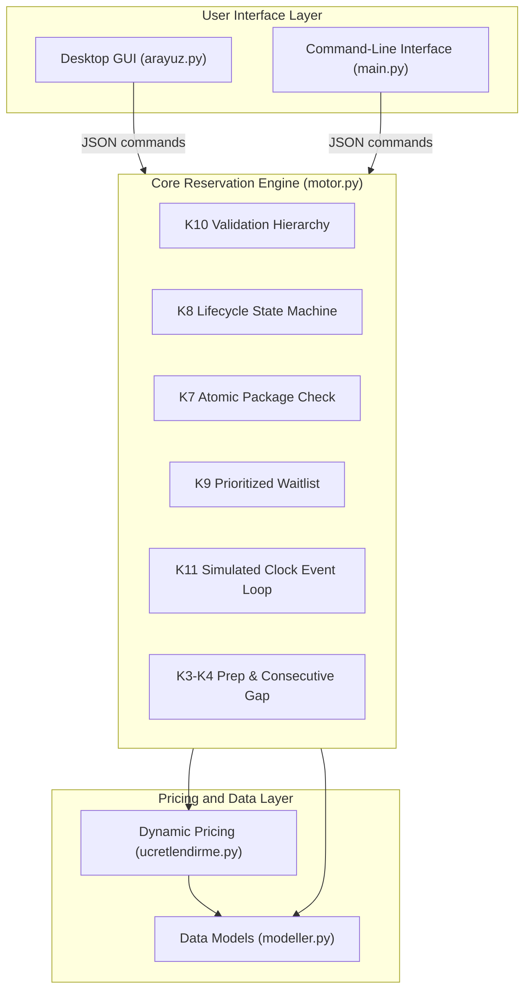
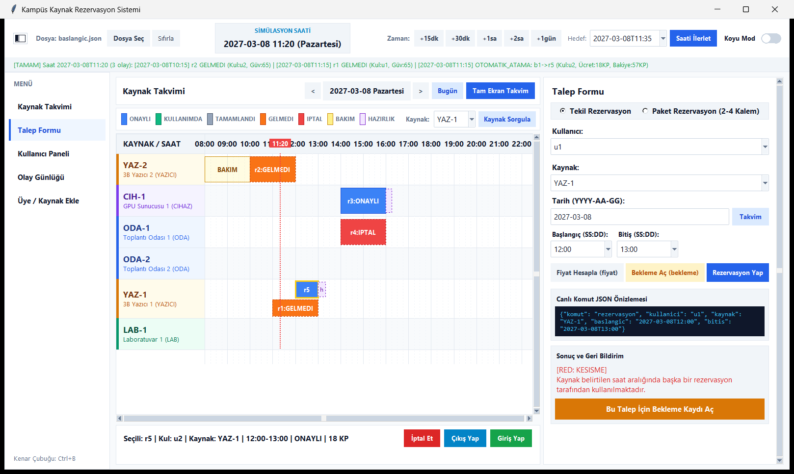
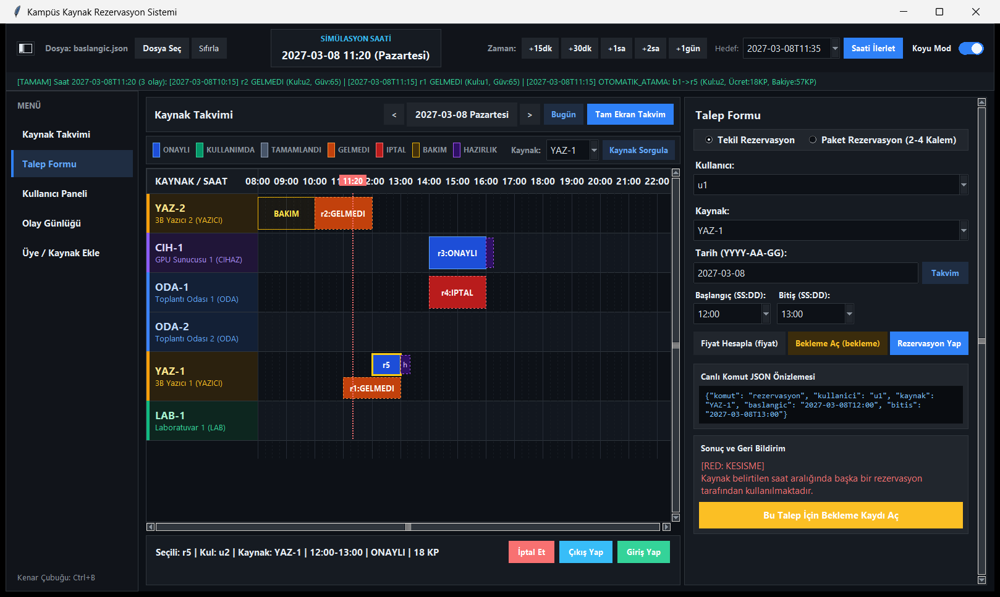

English | [Türkçe](README.tr.md)

# Campus Resource Reservation System

**Kocaeli University - Department of Computer Engineering**  
**Software Laboratory I (2026-2027 Fall), Project I**  
**Author:** Yiğit Karabacak (`240201025`)

---

## 1. Overview

Shared academic and technical resources on a university campus (meeting rooms, laboratories, 3D printers, and GPU servers) require scheduling rules beyond simple time-slot overlap checks. Equipment cooling or preparation intervals between uses, scheduled maintenance windows, user role permissions, weekly point quotas, dynamic congestion pricing, and attendance reliability all affect allocation decisions.

This project implements a rule-based campus resource reservation engine paired with a desktop application in Python 3.11+ using only the standard library (`dataclasses`, `datetime`, `json`, `math`, `calendar`, `tkinter`). The system stores state in memory without an external database and exposes identical scheduling logic through both a JSON Lines command-line interface ([main.py](main.py)) and a Tkinter graphical interface ([arayuz.py](arayuz.py)).

---

## 2. System Architecture

The software separates user interfaces, scheduling logic, dynamic pricing, and data models into four loosely coupled modules (Figure 1, adapted from [240201025.pdf](240201025.pdf)).



*Figure 1. Modular four-layer architecture separating UI adapters from validation, state transitions, and pricing.*

### In-Memory Data Models

Configuration data is loaded at startup from [baslangic.json](baslangic.json) and held in memory using `@dataclass` structures defined in [modeller.py](modeller.py). All timestamps follow the strict 16-character format `YYYY-MM-DDTHH:MM`:

- `KaynakTuru`: `ad`, `hazirlik_dk`, `temel_ucret`, `enerji_yogun`, `sertifika`.
- `Rol`: `ad`, `haftalik_kota`, `ileri_gun`, `azami_sure_dk`.
- `Kaynak`: `id`, `ad`, `tur`, `izinli_roller`.
- `Kullanici`: `id`, `ad`, `rol`, `sertifikalar`, `bakiye`, `guvenilirlik` (integer in `[0, 100]`).
- `Rezervasyon`: `id`, `kullanici`, `kaynak`, `baslangic`, `bitis`, `ucret`, `durum`, `paket`.
- `BakimPenceresi`: `kaynak`, `baslangic`, `bitis`.
- `BeklemeKaydi`: `id`, `kullanici`, `kaynak`, `baslangic`, `bitis`, `kayit_saati`.

---

## 3. Core Rules and Algorithms

### Dynamic Pricing Engine (K5)

Reservation fees are denominated in Resource Points (KP) and computed in [ucretlendirme.py](ucretlendirme.py) across discrete 15-minute slices from `08:00` to `22:00`:

$$\text{fee} = \text{round\_half\_up}\left(\sum_{\text{slice}} \text{temel\_ucret} \times 0.25 \times \text{bm} \times \text{pm}\right)$$

1. **Two-Hour Time Bands:** Operating hours are partitioned into seven two-hour bands: `08-10`, `10-12`, `12-14`, `14-16`, `16-18`, `18-20`, and `20-22`.
2. **Occupancy Ratio:** For each band and resource type at request time:

$$\text{occupancy} = \frac{\text{total occupied minutes in the band}}{\text{active resources of that type} \times 120}$$

   Only `ONAYLI` and `KULLANIMDA` reservations count toward occupancy; the candidate request and maintenance windows are excluded. Dynamically added resources (`kaynak_ekle`) enter the denominator.
3. **Band Multiplier ($\text{bm}$):** Determined by a 5-step threshold function ($\text{bm} = 1 + 0.25 \times \lfloor 4 \times \text{occupancy} \rfloor$):

| Occupancy Range | Band Multiplier ($\text{bm}$) |
| :--- | :---: |
| `0.00 <= occupancy < 0.25` | 1.00 |
| `0.25 <= occupancy < 0.50` | 1.25 |
| `0.50 <= occupancy < 0.75` | 1.50 |
| `0.75 <= occupancy < 1.00` | 1.75 |
| `occupancy = 1.00` | 2.00 |

4. **Peak Multiplier ($\text{pm}$):** Slices in `10:00-16:00` apply `1.5` when `enerji_yogun` is `true`, and `1.0` otherwise.
5. **Half-Up Rounding:** Total slice cost is rounded to the nearest integer via `math.floor(total + 0.5)`.

### 13-Step Validation Hierarchy (K10)

Every reservation, price query, or package item check in [motor.py](motor.py) runs through a fixed 13-step priority order and returns the first violated error code:

1. `BULUNAMADI`: Undefined user or resource ID.
2. `ZAMAN_ADIMI_HATASI`: Non-15-minute timestamp step, invalid format, or end <= start.
3. `GECMIS_ZAMAN`: Start time is earlier than the current simulated clock.
4. `CALISMA_SAATI_DISI`: Crosses day boundary or falls outside `08:00-22:00`.
5. `SURE_SINIRI`: Duration < 30 minutes or exceeds the user's role limit (`azami_sure_dk`).
6. `ILERI_TARIH_SINIRI`: Exceeds role advance-booking horizon (capped at 1 day when `guvenilirlik < 50`).
7. `ROL_IZNI_YOK`: User role is not in the resource's `izinli_roller` list.
8. `SERTIFIKA_YOK`: User lacks the certificate required by the resource type.
9. `BAKIM`: Overlaps a scheduled maintenance window.
10. `KESISME`: Overlaps an active `ONAYLI` or `KULLANIMDA` reservation.
11. `HAZIRLIK_IHLALI`: Violates the type-specific preparation/cooling buffer `hazirlik_dk` before or after another `ONAYLI`, `KULLANIMDA`, or `TAMAMLANDI` reservation (K3).
12. `ARDISIK_KULLANIM`: Same user has another `ONAYLI`, `KULLANIMDA`, or `TAMAMLANDI` reservation on the same resource within 60 minutes (K4).
13. `BAKIYE_YETERSIZ`: User's KP balance is below the computed fee.

### Packages, Waitlist, Lifecycle, and Reliability (K6-K9)

- **Atomic Packages (K7):** Requests of 2-4 items are accepted or rejected as one unit. Validation checks `BULUNAMADI`, `PAKET_BOYUTU`, `GUVENILIRLIK_DUSUK` (`guvenilirlik < 50`), per-item `PAKET_RED` (K10 excluding balance), `PAKET_ICI_KESISME` (intra-package overlap, prep gap, or 60-minute consecutive rule), and total `BAKIYE_YETERSIZ`.
- **Prioritized Waitlist (K9):** Allowed only when single validation hits `KESISME` or `HAZIRLIK_IHLALI` (otherwise returns `BEKLEME_GEREKSIZ`). When capacity frees via no-show, cancellation, or early check-out, expired waitlist entries are pruned and remaining candidates are ordered by `(-guvenilirlik, kayit_saati, id_num)`; the first candidate passing K10 receives `OTOMATIK_ATAMA`.
- **Lifecycle and Reliability (K8):** Check-in (`giris`) moves `ONAYLI -> KULLANIMDA` within `[start - 10m, start + 15m]`. Normal completion awards `+2` reliability (`TAMAMLANDI`); early check-out (`cikis`) truncates `bitis` to the current clock and scans the waitlist without modifying score or fee. Missing the check-in window transitions to `GELMEDI` with `-15` reliability and zero refund. Cancellations (`iptal`) refund 100% (`>= 24h` remaining), `floor(fee * 0.5)` (`2-24h`), or 0% with `-5` reliability (`< 2h`), capped at the role's weekly quota (K6). Weekly balances reset every Monday at `00:00`.

### Simulated Clock Event Loop (K11)

When advancing the simulated clock via the `saat` command, [motor.py](motor.py) walks chronological boundary events iteratively (Algorithm 1):

```text
Algorithm 1: K11 Simulated Clock Advance and Dynamic Event Loop
Input : target_time
Output: events_list (ordered chronologically)

if target_time < current_time then
    return RED ("SAAT_GERI")

while current_time < target_time do
    candidates <- empty set
    next_mon   <- next Monday 00:00 strictly after current_time
    if current_time < next_mon <= target_time then
        add next_mon to candidates
    for each r in KULLANIMDA with current_time < r.end <= target_time do
        add r.end to candidates
    for each r in ONAYLI with current_time < r.start + 15m <= target_time do
        add r.start + 15m to candidates
    if candidates is empty then
        break

    step <- min(candidates)
    current_time <- step

    if step == next_mon then
        reset all user balances to role weekly_quota ("HAFTALIK_SIFIRLAMA")
    for each r in KULLANIMDA with r.end == step ordered by numeric id do
        r.status <- TAMAMLANDI
        r.user.reliability <- min(100, r.user.reliability + 2)
    for each r in ONAYLI with r.start + 15m == step ordered by numeric id do
        r.status <- GELMEDI
        r.user.reliability <- max(0, r.user.reliability - 15)
    for each freed resource r in the no-show order above do
        scan resource waitlist ("OTOMATIK_ATAMA")

current_time <- target_time
return events_list
```

---

## 4. Desktop Application (GUI)

The desktop interface in [arayuz.py](arayuz.py) holds zero scheduling or validation rules; every form submission sends a JSON command directly to `RezervasyonMotoru.komut_isle` and displays the returned status or error description.

Interface features implemented in the Tkinter application:

- **Collapsible Sidebar and Views:** Toggled via the top-bar icon button or `Ctrl+B`, exposing `Kaynak Takvimi`, `Talep Formu`, `Kullanıcı Paneli`, `Olay Günlüğü`, and `Üye / Kaynak Ekle`. Selecting `Talep Formu` (or clicking `Yeni Talep Oluştur` from the calendar) opens the form side-by-side with the live resource timeline.
- **Light and Dark Themes:** Paired Tailwind Slate light palette and GitHub Primer Dark palette controlled via a vector canvas switch. Resource type columns are color-coded per `kaynak_turleri` entry in both modes.
- **Timeline Sub-Lanes and Controls:** Active reservations, maintenance blocks, preparation strips (`h`), and canceled/no-show items render without overlapping via automatic sub-lanes (`_hesapla_alt_seritler`). Direct check-in, check-out, and cancellation buttons operate on clicked calendar or table rows.
- **Standard-Library Date Picker and Live Previews:** A pop-up calendar built with Python's `calendar` module lets users pick any date (keeping past and future dates unlocked so the core engine still receives and validates invalid inputs). Forms display a live JSON command preview, per-row `PAKET_RED` diagnostics, and a one-click waitlist action on `KESISME` or `HAZIRLIK_IHLALI` rejections.


*Figure 2. Desktop application in light mode showing per-type resource coloring, sub-lane scheduling (`YAZ-1`), live JSON preview, and conflict feedback alongside the calendar.*


*Figure 3. Desktop application in dark mode synchronized across the sidebar, timeline canvas, and form widgets.*

---

## 5. Requirements and Usage

- **Runtime:** Python 3.11 or newer.
- **Dependencies:** Standard library only (no `pip install` needed).

### CLI Execution

Linux / macOS / Git Bash:
```bash
chmod +x calistir.sh
./calistir.sh baslangic.json komutlar.jsonl > sonuclar.jsonl
```

Windows (CMD):
```bat
calistir.bat baslangic.json komutlar.jsonl > sonuclar.jsonl
```

Windows PowerShell (use `cmd /c` so output redirection stays UTF-8 rather than UTF-16LE):
```powershell
cmd /c "calistir.bat baslangic.json komutlar.jsonl > sonuclar.jsonl"
```

Direct Python execution:
```bash
python main.py baslangic.json komutlar.jsonl > sonuclar.jsonl
```

### Desktop GUI Execution

Linux / macOS:
```bash
chmod +x calistir_arayuz.sh
./calistir_arayuz.sh
```

Windows:
```bat
calistir_arayuz.bat
```

Direct Python execution:
```bash
python arayuz.py
```

On startup, the GUI loads `baslangic.json` from the working directory. The `Dosya Seç` and `Sıfırla` controls reload any initial JSON file and reset all in-memory simulation state.

---

## 6. Verification and Test Results

Outputs are verified using [dogrula.py](dogrula.py), which performs line-by-line recursive comparison of JSON field names, data types (distinguishing `int` from `float`), and values:

```bash
python main.py baslangic.json komutlar.jsonl > sonuclar.jsonl
python dogrula.py sonuclar.jsonl beklenen_sonuclar.jsonl

python main.py baslangic.json test_kapsamli_komutlar.jsonl > test_kapsamli_sonuclar.jsonl
python dogrula.py test_kapsamli_sonuclar.jsonl test_kapsamli_beklenen.jsonl
```

| Test Suite | Commands | Scope | Errors | Exact Match |
| :--- | :---: | :--- | :---: | :---: |
| Specification Reference (`komutlar.jsonl`) | 19 | K1-K11 reference scenario | 0 | 100% |
| Extended Boundary Suite (`test_kapsamli_komutlar.jsonl`) | 80 | All 13 K10 error codes, K1-K11 boundaries, atomic packages, event ordering | 0 | 100% |

Note: [240201025.pdf](240201025.pdf) reports the earlier 72-command test stage prior to 8 boundary-value cases later added to [olustur_kapsamli_testler.py](olustur_kapsamli_testler.py) (bringing the suite to 80 commands).

### Reference Scenario Execution Summary (19 Commands)

| No | Command | Result | Applied Rule |
| :---: | :--- | :--- | :--- |
| 1-4 | `kullanici_ekle` / `kaynak_ekle` | `TAMAM` | Registered `u1`, `u2`, `YAZ-1`, and `LAB-1` |
| 5 | `rezervasyon (u1, YAZ-1, 11:00-13:00)` | `TAMAM (r1, fee: 36, bal: 84)` | Empty band (1.0), peak (1.5): `8 * 3 * 1.0 * 1.5 = 36 KP` |
| 6 | `rezervasyon (u2, YAZ-2, 10:00-12:00)` | `TAMAM (r2, fee: 45, bal: 75)` | Occupancy 0.25 -> band multiplier 1.25 -> `45 KP` |
| 7 | `rezervasyon (u2, YAZ-2, 12:30-13:30)` | `RED [ARDISIK_KULLANIM]` | Same user/resource gap is 30 min (< 60 min) |
| 8 | `rezervasyon (u2, LAB-1, 14:00-15:00)` | `RED [SERTIFIKA_YOK]` | User `u2` lacks `LAB_GUVENLIK` |
| 9 | `rezervasyon (u1, YAZ-1, 13:10-14:00)` | `RED [ZAMAN_ADIMI_HATASI]` | `13:10` does not align to 15-minute steps |
| 10 | `rezervasyon (u1, YAZ-1, 13:15-14:00)` | `RED [HAZIRLIK_IHLALI]` | `r1` ends at `13:00`; 20-min prep requires `13:20` |
| 11 | `fiyat (u3, CIH-1, 14:00-16:00)` | `TAMAM (fee: 48)` | Non-mutating dynamic fee query |
| 12 | `paket (u3, CIH-1 & ODA-1)` | `TAMAM (p1: r3, r4, total: 56, bal: 244)` | Two-item package approved atomically (`48 + 8 KP`) |
| 13 | `rezervasyon (u1, CIH-1, 16:30-17:30)` | `RED [ROL_IZNI_YOK]` | K10 evaluates role permission before certificate check |
| 14 | `rezervasyon (u1, ODA-2, 2027-03-16)` | `RED [ILERI_TARIH_SINIRI]` | Exceeds 7-day student horizon (max `2027-03-15 08:00`) |
| 15 | `bekleme (u2, YAZ-1, 12:00-13:00)` | `TAMAM (b1, pos: 1)` | Waitlist entry created for interval conflicting with `r1` |
| 16 | `saat (2027-03-08T11:20)` | `TAMAM (3 events)` | `r2 GELMEDI`, `r1 GELMEDI`, `OTOMATIK_ATAMA (b1->r5, 18 KP)` |
| 17 | `giris (r1)` | `RED [DURUM_HATASI]` | Check-in rejected because `r1` is in `GELMEDI` state |
| 18 | `iptal (r4)` | `TAMAM (refund: 4, bal: 248, rel: 80)` | 2h 40m before start; 50% refund (`4 KP`), no penalty |
| 19 | `sorgu (kullanici u2)` | `TAMAM (bal: 57, rel: 65, [r2, r5])` | Confirmed updated balance, reliability, and reservation list |

### Complexity Summary

- Single-request validation in [motor.py](motor.py) runs in `O(N)` time with respect to stored reservations and maintenance windows.
- Band occupancy calculation in [ucretlendirme.py](ucretlendirme.py) uses an `O(1)` set membership lookup for matching resource IDs of the requested type.
- Simulation state resides strictly in memory without disk persistence during command execution.

---

## 7. Repository Structure

| File | Description |
| :--- | :--- |
| [modeller.py](modeller.py) | `@dataclass` domain models and strict `YYYY-MM-DDTHH:MM` timestamp helpers |
| [ucretlendirme.py](ucretlendirme.py) | Dynamic pricing engine (15-min slices, 7 bands, occupancy multiplier, half-up rounding) |
| [motor.py](motor.py) | Core state machine (`RezervasyonMotoru`) enforcing rules K1-K11 |
| [main.py](main.py) | JSON Lines CLI entry point |
| [arayuz.py](arayuz.py) | Tkinter desktop interface with themes, sidebar, calendar picker, and timeline canvas |
| [calistir.sh](calistir.sh) / [calistir.bat](calistir.bat) | Cross-platform CLI runners |
| [calistir_arayuz.sh](calistir_arayuz.sh) / [calistir_arayuz.bat](calistir_arayuz.bat) | Cross-platform GUI launchers |
| [baslangic.json](baslangic.json) | Initial campus state fixture |
| [komutlar.jsonl](komutlar.jsonl) | 19-command reference input stream |
| [beklenen_sonuclar.jsonl](beklenen_sonuclar.jsonl) | Expected reference output stream |
| [test_kapsamli_komutlar.jsonl](test_kapsamli_komutlar.jsonl) | 80-command boundary-value test stream |
| [test_kapsamli_beklenen.jsonl](test_kapsamli_beklenen.jsonl) | Expected outputs for the 80-command suite |
| [olustur_kapsamli_testler.py](olustur_kapsamli_testler.py) | Generator and self-check script for the 80-command suite |
| [dogrula.py](dogrula.py) | Recursive JSONL field-and-type verification script |
| [docs/gui_light.png](docs/gui_light.png) / [docs/gui_dark.png](docs/gui_dark.png) | GUI screenshots in light and dark themes |
| [240201025.pdf](240201025.pdf) / [rapor.tex](rapor.tex) | Submitted IEEE technical report and LaTeX source |
| [README.md](README.md) / [README.tr.md](README.tr.md) | English and Turkish documentation |
