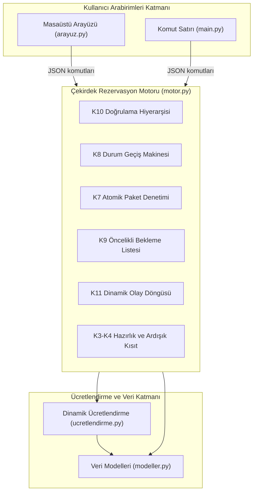
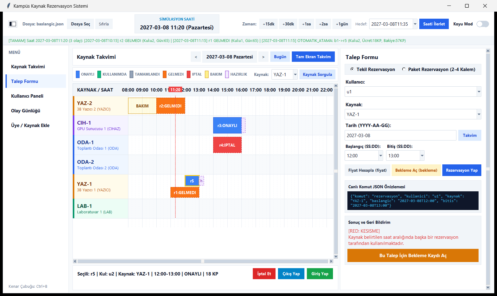
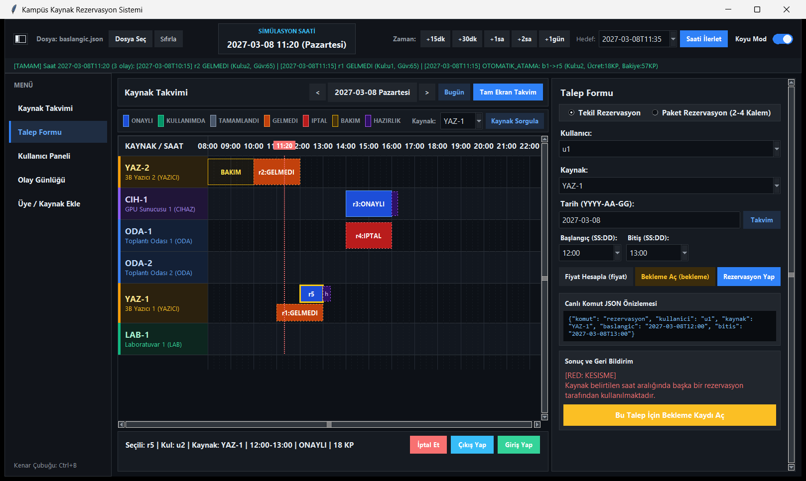

[English](README.md) | Türkçe

# Kampüs Kaynak Rezervasyon Sistemi

**Kocaeli Üniversitesi - Bilgisayar Mühendisliği Bölümü**  
**Yazılım Laboratuvarı I (2026-2027 Güz), Proje I**  
**Hazırlayan:** Yiğit Karabacak (`240201025`)

---

## 1. Genel Bakış

Üniversite yerleşkelerinde ortak kullanıma açık kaynakların (toplantı odaları, laboratuvarlar, 3D yazıcılar ve GPU sunucuları) paylaşımı, basit takvim çakışma kontrolünün ötesinde kurallar gerektirir. İki kullanım arasındaki soğuma veya hazırlık süreleri, planlı bakım pencereleri, kullanıcı rol yetkileri, haftalık puan kotaları, yoğunluğa göre değişen ücretler ve kullanıcı güvenilirlik puanları tahsis kararlarını doğrudan etkiler.

Bu projede, kural tabanlı bir kaynak rezervasyon motoru ve bu motoru doğrudan kullanan bir masaüstü uygulaması Python 3.11+ standart kütüphanesi (`dataclasses`, `datetime`, `json`, `math`, `calendar`, `tkinter`) üzerinde harici paket kullanılmadan geliştirilmiştir. Sistem tüm durumu bellekte tutar ve aynı çekirdek karar mekanizmasını hem JSON Lines komut satırı ([main.py](main.py)) hem de Tkinter masaüstü arayüzü ([arayuz.py](arayuz.py)) üzerinden sunar.

---

## 2. Sistem Mimarisi

Yazılım, sorumlulukların ayrılığı ilkesi doğrultusunda birbirine gevşek bağlı dört katmanlı bir yapıda düzenlenmiştir (Şekil 1, [240201025.pdf](240201025.pdf) temel alınarak).



*Şekil 1. Arayüz katmanını doğrulama, durum geçişleri ve dinamik ücretlendirmeden ayıran dört katmanlı modüler mimari.*

### Bellek İçi Veri Modelleri

Başlangıç yapılandırması çalışma anında [baslangic.json](baslangic.json) dosyasından okunur ve [modeller.py](modeller.py) içindeki `@dataclass` yapılarıyla bellekte tutulur. Tüm zaman damgaları 16 karakterlik katı `YYYY-MM-DDTHH:MM` biçimini izler:

- `KaynakTuru`: `ad`, `hazirlik_dk`, `temel_ucret`, `enerji_yogun`, `sertifika`.
- `Rol`: `ad`, `haftalik_kota`, `ileri_gun`, `azami_sure_dk`.
- `Kaynak`: `id`, `ad`, `tur`, `izinli_roller`.
- `Kullanici`: `id`, `ad`, `rol`, `sertifikalar`, `bakiye`, `guvenilirlik` (`[0, 100]` tamsayı).
- `Rezervasyon`: `id`, `kullanici`, `kaynak`, `baslangic`, `bitis`, `ucret`, `durum`, `paket`.
- `BakimPenceresi`: `kaynak`, `baslangic`, `bitis`.
- `BeklemeKaydi`: `id`, `kullanici`, `kaynak`, `baslangic`, `bitis`, `kayit_saati`.

---

## 3. Çekirdek Kurallar ve Algoritmalar

### Dinamik Ücretlendirme Motoru (K5)

Rezervasyon ücretleri Kaynak Puanı (KP) cinsinden hesaplanır ve [ucretlendirme.py](ucretlendirme.py) içinde `08:00-22:00` aralığındaki 15 dakikalık ayrık dilimler üzerinden belirlenir:

$$\text{ücret} = \text{yuvarla}\left(\sum_{\text{dilim}} \text{temel\_ucret} \times 0.25 \times \text{bc} \times \text{pc}\right)$$

1. **Zaman Bantları:** Çalışma saatleri ikişer saatlik yedi banda ayrılır: `08-10`, `10-12`, `12-14`, `14-16`, `16-18`, `18-20` ve `20-22`.
2. **Doluluk Oranı:** İlgili bant ve kaynak türü için talep anında şu şekilde bulunur:

$$\text{doluluk} = \frac{\text{banttaki toplam dolu dakika}}{\text{ilgili türdeki aktif kaynak sayısı} \times 120}$$

   Yalnızca `ONAYLI` ve `KULLANIMDA` rezervasyonlar sayılır; talebin kendisi ve bakım pencereleri dahil edilmez. `kaynak_ekle` ile eklenen kaynaklar paydaya katılır.
3. **Bant Çarpanı ($\text{bc}$):** Beş kademeli merdiven fonksiyonu ile belirlenir ($\text{bc} = 1 + 0.25 \times \lfloor 4 \times \text{doluluk} \rfloor$):

| Doluluk Aralığı | Bant Çarpanı ($\text{bc}$) |
| :--- | :---: |
| `0.00 <= doluluk < 0.25` | 1.00 |
| `0.25 <= doluluk < 0.50` | 1.25 |
| `0.50 <= doluluk < 0.75` | 1.50 |
| `0.75 <= doluluk < 1.00` | 1.75 |
| `doluluk = 1.00` | 2.00 |

4. **Pik Çarpanı ($\text{pc}$):** `10:00-16:00` aralığındaki dilimlerde tür `enerji_yogun: true` ise `1.5`, aksi halde `1.0` uygulanır.
5. **Yuvarlama:** Dilim toplamı yarım-yukarı kuralıyla tamsayıya yuvarlanır (`math.floor(toplam + 0.5)`).

### 13 Adımlı Doğrulama Sırası (K10)

[motor.py](motor.py) içindeki her tekil rezervasyon, fiyat sorgusu veya paket kalemi 13 aşamalı sabit sırayla denetlenir ve ilk ihlalin kodunu döner:

1. `BULUNAMADI`: Kullanıcı veya kaynak ID değeri tanımsız.
2. `ZAMAN_ADIMI_HATASI`: 15 dakikalık adım dışı, hatalı biçim veya bitiş <= başlangıç.
3. `GECMIS_ZAMAN`: Başlangıç saati mevcut simüle saatten önce.
4. `CALISMA_SAATI_DISI`: Gün aşımı veya `08:00-22:00` çalışma saati dışı.
5. `SURE_SINIRI`: Süre < 30 dakika veya rol azami süresinden fazla (`azami_sure_dk`).
6. `ILERI_TARIH_SINIRI`: Rolün ileri tarih sınırını aşma (`guvenilirlik < 50` ise sınır 1 gündür).
7. `ROL_IZNI_YOK`: Kullanıcının rolü kaynağın `izinli_roller` listesinde yer almıyor.
8. `SERTIFIKA_YOK`: Kaynak türünün gerektirdiği sertifika kullanıcıda eksik.
9. `BAKIM`: Talep planlı bakım penceresiyle kesişiyor.
10. `KESISME`: Aktif bir `ONAYLI` veya `KULLANIMDA` rezervasyonla çakışıyor.
11. `HAZIRLIK_IHLALI`: Önceki veya sonraki `ONAYLI`, `KULLANIMDA` ya da `TAMAMLANDI` rezervasyonla arasındaki `hazirlik_dk` hazırlık boşluğunu ihlal ediyor (K3).
12. `ARDISIK_KULLANIM`: Aynı kullanıcının aynı kaynakta 60 dakika içinde başka bir `ONAYLI`, `KULLANIMDA` veya `TAMAMLANDI` rezervasyonu bulunuyor (K4).
13. `BAKIYE_YETERSIZ`: Kullanıcının KP bakiyesi ücreti karşılamıyor.

### Paketler, Bekleme Listesi, Durum Makinesi ve Güvenilirlik (K6-K9)

- **Atomik Paket Denetimi (K7):** 2-4 kalemlik talepler tek işlem olarak onaylanır veya reddedilir. Sırasıyla `BULUNAMADI`, `PAKET_BOYUTU`, `GUVENILIRLIK_DUSUK` (`guvenilirlik < 50`), kalem bazında `PAKET_RED` (bakiye hariç K10), `PAKET_ICI_KESISME` (paket içi çakışma, hazırlık veya 60 dakika ardışık kuralı) ve toplam `BAKIYE_YETERSIZ` denetlenir.
- **Öncelikli Bekleme Listesi (K9):** Yalnızca `KESISME` veya `HAZIRLIK_IHLALI` durumunda açılabilir (kaynak müsaitse `BEKLEME_GEREKSIZ` döner). Yer boşaldığında başlangıcı geçmiş kayıtlar temizlenir; adaylar `(-guvenilirlik, kayit_saati, id_num)` sırasıyla taranır ve K10 kontrolünü geçen ilk adaya `OTOMATIK_ATAMA` yapılır.
- **Yaşam Döngüsü ve Güvenilirlik (K8):** Giriş (`giris`) işlemi `[bas - 10 dk, bas + 15 dk]` penceresinde `ONAYLI -> KULLANIMDA` geçişini yapar. Normal bitişte `TAMAMLANDI` ile `+2` puan eklenir; erken çıkışta (`cikis`) bitiş zamanı simüle saate çekilip bekleme listesi taranır, puan ve ücret değişmez. Giriş penceresi kaçırıldığında `GELMEDI` oluşur, `-15` puan düşülür ve iade verilmez. İptalde (`iptal`) kalan süre `>= 24 sa` ise %100, `2-24 sa` ise `floor(ucret * 0.5)`, `< 2 sa` ise %0 iade ve `-5` puan uygulanır; iade rol kotasını aşamaz (K6). Haftalık bakiyeler her Pazartesi `00:00` anında yenilenir.

### Simüle Saat Olay Döngüsü (K11)

Simüle saati ilerleten `saat` komutu [motor.py](motor.py) içinde aradaki tüm sınır olaylarını kronolojik sırayla yürütür (Algoritma 1):

```text
Algoritma 1: K11 Simüle Saat İlerletme ve Dinamik Olay Döngüsü
Girdi : hedef_saat
Çıktı : olaylar_listesi (kronolojik sıra)

eğer hedef_saat < mevcut_saat ise
    döndür RED ("SAAT_GERI")

mevcut_saat < hedef_saat olduğu sürece
    adaylar <- boş küme
    pzt     <- mevcut_saat sonrasındaki ilk Pazartesi 00:00
    eğer mevcut_saat < pzt <= hedef_saat ise
        pzt zamanını adaylar kümesine ekle
    her r (durumu KULLANIMDA ve mevcut_saat < r.bitis <= hedef_saat) için
        r.bitis zamanını adaylar kümesine ekle
    her r (durumu ONAYLI ve mevcut_saat < r.baslangic + 15 dk <= hedef_saat) için
        r.baslangic + 15 dk zamanını adaylar kümesine ekle
    eğer adaylar boş ise
        döngüden çık

    adim <- min(adaylar)
    mevcut_saat <- adim

    eğer adim == pzt ise
        tüm kullanıcı bakiyelerini rol kotasına eşitle ("HAFTALIK_SIFIRLAMA")
    her r (KULLANIMDA ve r.bitis == adim, artan id sırasıyla) için
        r.durum <- TAMAMLANDI
        r.kullanici.guvenilirlik <- min(100, r.kullanici.guvenilirlik + 2)
    her r (ONAYLI ve r.baslangic + 15 dk == adim, artan id sırasıyla) için
        r.durum <- GELMEDI
        r.kullanici.guvenilirlik <- max(0, r.kullanici.guvenilirlik - 15)
    gelmeme olaylarının sırasıyla boşalan her kaynak için
        bekleme listesini tara ("OTOMATIK_ATAMA")

mevcut_saat <- hedef_saat
döndür olaylar_listesi
```

---

## 4. Masaüstü Uygulaması (GUI)

[arayuz.py](arayuz.py) içindeki masaüstü uygulaması iş kuralı barındırmaz; tüm kullanıcı talepleri doğrudan `RezervasyonMotoru.komut_isle` yöntemine JSON komutu olarak iletilir ve motorun döndürdüğü sonuçlar ekranda gösterilir.

Arayüzün sunduğu başlıca işlevler:

- **Açılır Kenar Çubuğu ve Bölümler:** Üst bardaki düğme veya `Ctrl+B` kısayolu ile açılıp kapanabilen yan menü üzerinden `Kaynak Takvimi`, `Talep Formu`, `Kullanıcı Paneli`, `Olay Günlüğü` ve `Üye / Kaynak Ekle` sayfaları yönetilir. `Talep Formu` açıldığında veya takvimden `Yeni Talep Oluştur` tıklandığında kaynak takvimi sol tarafta görünür kalır.
- **Açık ve Koyu Tema:** Tailwind Slate açık paleti ve GitHub Primer Dark koyu paleti arasında geçiş yapan canvas anahtar (`Koyu Mod`) tüm panelleri, tabloları ve takvimi günceller. Takvimin en solundaki kaynak sütunu her iki temada da `kaynak_turleri` sırasına göre tür bazlı renklendirilir.
- **Alt Şerit Çizimi ve Doğrudan Eylemler:** Aynı kaynakta çakışan `IPTAL` veya `GELMEDI` kayıtları yeni rezervasyonlar ve hazırlık süreleri (`h`) ile çakışmadan ayrı alt şeritlerde gösterilir (`_hesapla_alt_seritler`). Takvim veya kullanıcı tablosundan seçilen kayıtlar üzerinde tek tıkla giriş, çıkış ve iptal uygulanır.
- **Takvim Seçici ve Canlı Önizleme:** Standart kütüphane `calendar` modülüyle hazırlanan açılır tarih seçici geçmiş ve ileri günleri engellemeden seçilebilir bırakır; böylece geçersiz tarihlerin reddedilmesi yine çekirdek motorda gerçekleşir. Formlarda canlı JSON komutu önizlemesi, satır bazlı `PAKET_RED` bilgisi ve `KESISME`/`HAZIRLIK_IHLALI` reddi sonrası tek tıkla bekleme kaydı düğmesi yer alır.


*Şekil 2. Açık mod masaüstü arayüzü: tür bazlı kaynak renklendirmesi, `YAZ-1` üzerinde alt şerit gösterimi, canlı JSON önizlemesi ve çakışma uyarısı.*


*Şekil 3. Koyu mod masaüstü arayüzü: kenar çubuğu, zaman çizelgesi ve form bileşenlerinin koyu tema görünümü.*

---

## 5. Gereksinimler ve Çalıştırma

- **Çalışma Ortamı:** Python 3.11 veya üzeri.
- **Bağımlılıklar:** Yalnızca standart kütüphane (`pip install` gerektirmez).

### Komut Satırı (CLI) Kullanımı

Linux / macOS / Git Bash:
```bash
chmod +x calistir.sh
./calistir.sh baslangic.json komutlar.jsonl > sonuclar.jsonl
```

Windows (CMD):
```bat
calistir.bat baslangic.json komutlar.jsonl > sonuclar.jsonl
```

Windows PowerShell (çıktının `UTF-16LE` yerine `UTF-8` yazılması için `cmd /c` ile çalıştırın):
```powershell
cmd /c "calistir.bat baslangic.json komutlar.jsonl > sonuclar.jsonl"
```

Doğrudan Python ile:
```bash
python main.py baslangic.json komutlar.jsonl > sonuclar.jsonl
```

### Masaüstü Uygulaması (GUI) Kullanımı

Linux / macOS:
```bash
chmod +x calistir_arayuz.sh
./calistir_arayuz.sh
```

Windows:
```bat
calistir_arayuz.bat
```

Doğrudan Python ile:
```bash
python arayuz.py
```

Uygulama açılışta çalışma dizinindeki `baslangic.json` dosyasını yükler. Üst çubuktaki `Dosya Seç` ve `Sıfırla` düğmeleri farklı bir başlangıç dosyası yükler veya bellek durumunu sıfırlar.

---

## 6. Doğrulama ve Test Sonuçları

Çıktılar, üretilen JSONL satırlarını alan adı, veri tipi (`int`/`float` ayrımı dahil) ve değer düzeyinde özyinelemeli olarak karşılaştıran [dogrula.py](dogrula.py) betiği ile doğrulanır:

```bash
python main.py baslangic.json komutlar.jsonl > sonuclar.jsonl
python dogrula.py sonuclar.jsonl beklenen_sonuclar.jsonl

python main.py baslangic.json test_kapsamli_komutlar.jsonl > test_kapsamli_sonuclar.jsonl
python dogrula.py test_kapsamli_sonuclar.jsonl test_kapsamli_beklenen.jsonl
```

| Test Kümesi | Komut | Kapsam | Hata | Eşleşme |
| :--- | :---: | :--- | :---: | :---: |
| Şartname Referans Senaryosu (`komutlar.jsonl`) | 19 | K1-K11 temel akış | 0 | %100 |
| Genişletilmiş Sınır Değer Seti (`test_kapsamli_komutlar.jsonl`) | 80 | 13 K10 hata kodu, K1-K11 sınırları, atomik paketler, olay sırası | 0 | %100 |

Not: Teslim edilen [240201025.pdf](240201025.pdf) raporu, [olustur_kapsamli_testler.py](olustur_kapsamli_testler.py) dosyasına sonradan eklenen 8 sınır değer senaryosundan önceki 72 komutluk aşamayı belgelemektedir; güncel depodaki test kümesi 80 komuttan oluşur.

### Örnek Senaryo Yürütme Özeti (19 Komut)

| No | Komut | Durum / Sonuç | Uygulanan Kural |
| :---: | :--- | :--- | :--- |
| 1-4 | `kullanici_ekle` / `kaynak_ekle` | `TAMAM` | `u1`, `u2`, `YAZ-1` ve `LAB-1` eklendi |
| 5 | `rezervasyon (u1, YAZ-1, 11:00-13:00)` | `TAMAM (r1, ücret: 36, bak: 84)` | Boş bant (1.0), pik (1.5): `8 * 3 * 1.0 * 1.5 = 36 KP` |
| 6 | `rezervasyon (u2, YAZ-2, 10:00-12:00)` | `TAMAM (r2, ücret: 45, bak: 75)` | Doluluk 0.25 -> bant çarpanı 1.25 -> `45 KP` |
| 7 | `rezervasyon (u2, YAZ-2, 12:30-13:30)` | `RED [ARDISIK_KULLANIM]` | Aynı kullanıcı ve kaynakta 30 dk boşluk (< 60 dk) |
| 8 | `rezervasyon (u2, LAB-1, 14:00-15:00)` | `RED [SERTIFIKA_YOK]` | `u2` kullanıcısında `LAB_GUVENLIK` sertifikası yok |
| 9 | `rezervasyon (u1, YAZ-1, 13:10-14:00)` | `RED [ZAMAN_ADIMI_HATASI]` | `13:10` değeri 15 dk adımlara oturmuyor |
| 10 | `rezervasyon (u1, YAZ-1, 13:15-14:00)` | `RED [HAZIRLIK_IHLALI]` | `r1` 13:00'da biter; 20 dk hazırlık ile en erken 13:20 |
| 11 | `fiyat (u3, CIH-1, 14:00-16:00)` | `TAMAM (ücret: 48)` | Durum değiştirmeden dinamik ücret hesaplandı |
| 12 | `paket (u3, CIH-1 & ODA-1)` | `TAMAM (p1: r3, r4, toplam: 56, bak: 244)` | İki kalem atomik olarak onaylandı (`48 + 8 KP`) |
| 13 | `rezervasyon (u1, CIH-1, 16:30-17:30)` | `RED [ROL_IZNI_YOK]` | K10 sırası rol iznini sertifikadan önce denetler |
| 14 | `rezervasyon (u1, ODA-2, 2027-03-16)` | `RED [ILERI_TARIH_SINIRI]` | Öğrenci 7 gün sınırı aşıldı (en geç `2027-03-15 08:00`) |
| 15 | `bekleme (u2, YAZ-1, 12:00-13:00)` | `TAMAM (b1, sıra: 1)` | `r1` ile kesişen aralık için bekleme kaydı açıldı |
| 16 | `saat (2027-03-08T11:20)` | `TAMAM (3 olay)` | `r2 GELMEDI`, `r1 GELMEDI`, `OTOMATIK_ATAMA (b1->r5, 18 KP)` |
| 17 | `giris (r1)` | `RED [DURUM_HATASI]` | `r1` `GELMEDI` durumunda olduğundan giriş reddedildi |
| 18 | `iptal (r4)` | `TAMAM (iade: 4, bak: 248, güv: 80)` | Başlangıca 2 sa 40 dk var; %50 iade (`4 KP`), ceza yok |
| 19 | `sorgu (kullanici u2)` | `TAMAM (bak: 57, güv: 65, [r2, r5])` | Güncel bakiye, güvenilirlik ve rezervasyon listesi doğrulandı |

### Karmaşıklık Özeti

- [motor.py](motor.py) içindeki tekil doğrulama, kayıtlı rezervasyon ve bakım penceresi sayısına göre `O(N)` karmaşıklığındadır.
- [ucretlendirme.py](ucretlendirme.py) içindeki bant doluluğu hesabı, ilgili kaynak türüne ait ID kümesini `O(1)` sürede denetler.
- Çalışma sırasındaki tüm veriler bellekte tutulur ve disk tabanlı veritabanı kullanılmaz.

---

## 7. Depo Yapısı

| Dosya | Açıklama |
| :--- | :--- |
| [modeller.py](modeller.py) | `@dataclass` veri yapıları ve `YYYY-MM-DDTHH:MM` zaman dönüştürücüleri |
| [ucretlendirme.py](ucretlendirme.py) | Dinamik ücretlendirme motoru (15 dk dilimler, 7 bant, doluluk çarpanı, yarım-yukarı yuvarlama) |
| [motor.py](motor.py) | K1-K11 kurallarını uygulayan durum makinesi (`RezervasyonMotoru`) |
| [main.py](main.py) | JSON Lines CLI giriş noktası |
| [arayuz.py](arayuz.py) | Tema geçişli, yan menülü, takvim seçicili Tkinter masaüstü arayüzü |
| [calistir.sh](calistir.sh) / [calistir.bat](calistir.bat) | Platformlar arası CLI çalıştırma betikleri |
| [calistir_arayuz.sh](calistir_arayuz.sh) / [calistir_arayuz.bat](calistir_arayuz.bat) | Platformlar arası GUI çalıştırma betikleri |
| [baslangic.json](baslangic.json) | Başlangıç durum dosyası |
| [komutlar.jsonl](komutlar.jsonl) | 19 komutluk referans girdi dosyası |
| [beklenen_sonuclar.jsonl](beklenen_sonuclar.jsonl) | Referans senaryo için beklenen çıktı dosyası |
| [test_kapsamli_komutlar.jsonl](test_kapsamli_komutlar.jsonl) | 80 komutluk sınır değer test dosyası |
| [test_kapsamli_beklenen.jsonl](test_kapsamli_beklenen.jsonl) | 80 komutluk test kümesi beklenen çıktıları |
| [olustur_kapsamli_testler.py](olustur_kapsamli_testler.py) | 80 komutluk test kümesini üreten ve doğrulayan betik |
| [dogrula.py](dogrula.py) | Alan ve tip düzeyinde özyinelemeli JSONL doğrulama aracı |
| [docs/gui_light.png](docs/gui_light.png) / [docs/gui_dark.png](docs/gui_dark.png) | Açık ve koyu tema arayüz ekran görüntüleri |
| [240201025.pdf](240201025.pdf) / [rapor.tex](rapor.tex) | Teslim edilen IEEE teknik raporu ve LaTeX kaynağı |
| [README.md](README.md) / [README.tr.md](README.tr.md) | İngilizce ve Türkçe proje belgeleri |
